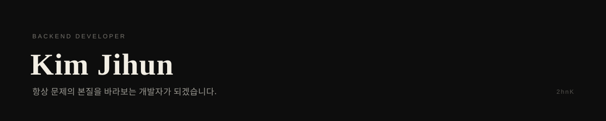

  

  
  
  

 

## Tech Stack

<table>
  <tr>
    <td><b>Backend</b></td>
    <td>
      
      
      
      
      
      
    </td>
  </tr>
  <tr>
    <td><b>Database</b></td>
    <td>
      
      
      
    </td>
  </tr>
  <tr>
    <td><b>AI</b></td>
    <td>
      
    </td>
  </tr>
  <tr>
    <td><b>DevOps</b></td>
    <td>
      
      
      
      
    </td>
  </tr>
  <tr>
    <td><b>Frontend</b></td>
    <td>
      
      
      
    </td>
  </tr>
</table>

## Featured Work

| Period | Project | Description |
| :-- | :-- | :-- |
| `2026.10 — 2026.11` | **SETRON** | SEMES 기업연계 · **반도체 장비 SW 버전 관리 자동화** |
| `2026.08 — 2026.09` | **[dib](https://github.com/dib-B101/dib)** | 실시간 라이브 경매와 AI 상품 검수를 제공하는 **C2C 중고 경매 플랫폼** |
| `2026.07 — 2026.08` | **[iRead](https://github.com/iRead-B105/iRead)** | 시선·발음 데이터를 활용한 **난독증 아동 맞춤형 읽기 훈련 시스템** |
| `2026.05 — 2026.06` | **[Soomgil](https://github.com/Soomgil/soomgil)** 🥈 | 생성형 AI와 공공데이터를 활용한 **취향 기반 여행 협업 플랫폼** |
| `2025.10 — 2025.12` | **[NLP Character Extraction](https://github.com/2hnK/NLP-Character-feature-extraction)** | Qwen3-VL 기반 **캐릭터 특성 추출 및 커플 매칭 예측 시스템** |
| `2025.03 — 2025.05` | **[나랏말싸미](https://github.com/2hnK/dyslexia-kit-backend)** 🥇 | 난독증 아동·청소년을 위한 **AI 교안 생성 서비스** |

## Experience

| Period | Experience |
| :-- | :-- |
| `2026.06` | **SSAFY 1학기 프로젝트 경진대회 우수상** |
| `2026.05 — 2026.10` | **2026 관광데이터 활용 공모전** |
| `2026.02` | **KICS 동계종합학술발표회 장려상** |
| `2026.01 — 현재` | **SSAFY 15기** |
| `2025.05` | **소중한 SW/AI 경진대회 1위** |
| `2024.03 — 2026.02` | **국립한밭대학교** |

## Certifications

| Certification | Issued | Issuer |
| :-- | :-- | :-- |
| **정보처리기사** | `2025.09` | 한국산업인력공단 |
| **SQLD** | `2025.06` | 한국데이터산업진흥원 |

 

## GitHub Activity

  
  

  

